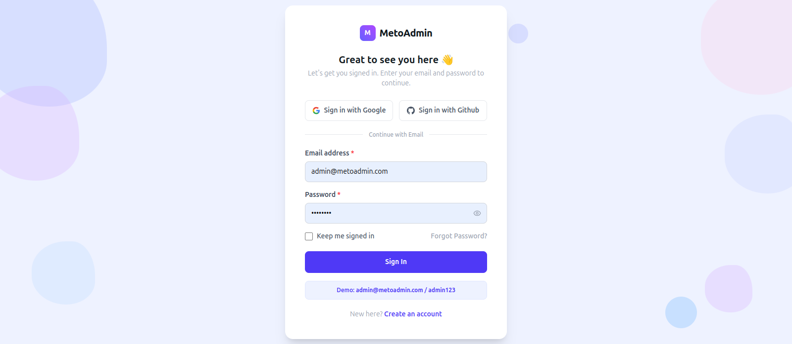
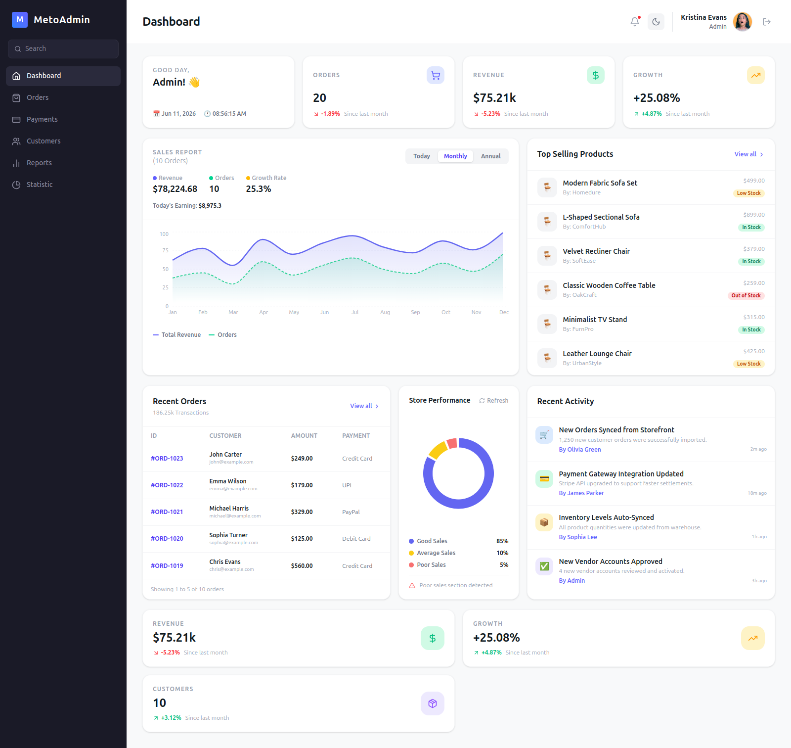
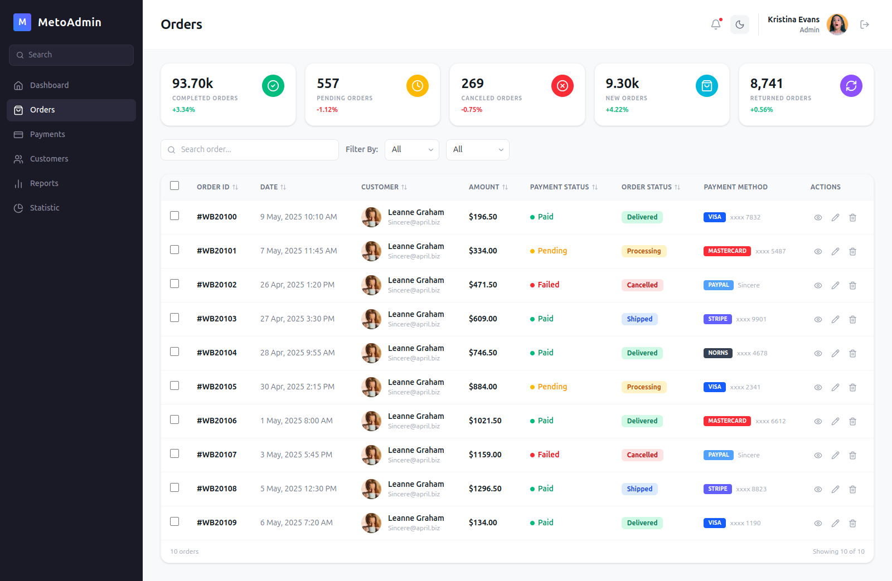
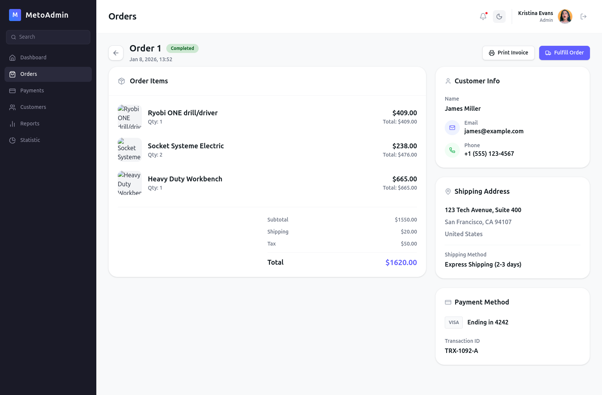
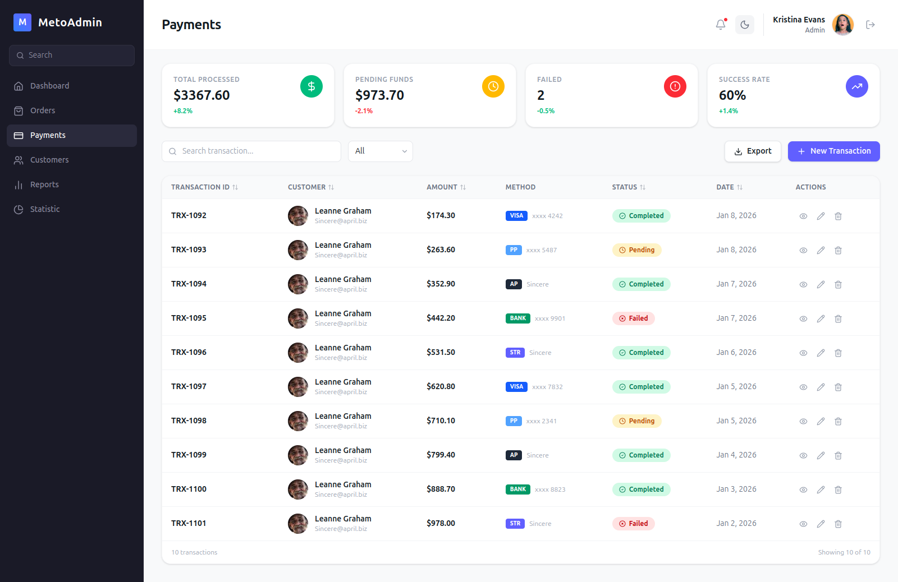
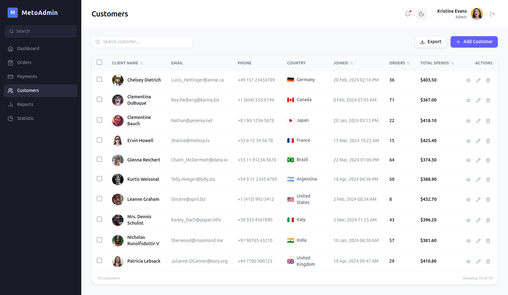
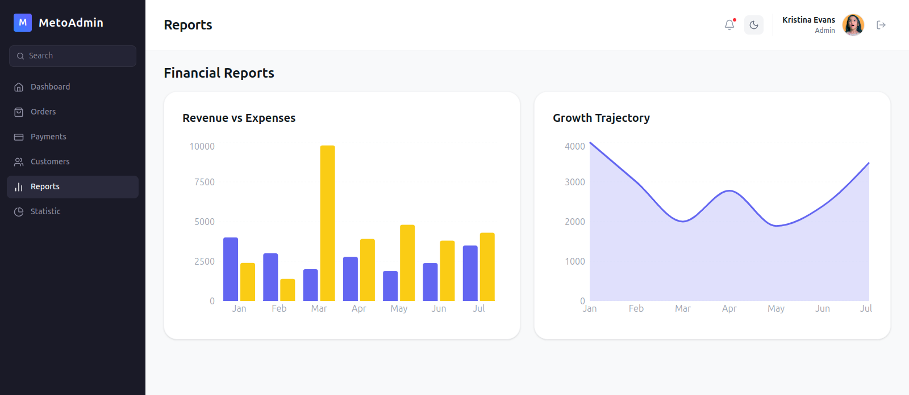
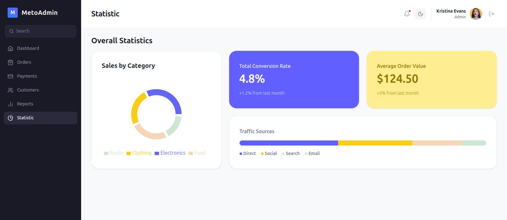

# MetoAdmin — Admin Dashboard

> A production-quality React admin dashboard built for real-world administrative use. Clean, responsive, and feature-complete SPA with REST API integration — ready to drop into any e-commerce or SaaS back-office.

---

## 📸 Screenshots

### Login

Branded login page with email/password form, show/hide password toggle, "Keep me signed in" checkbox, Google & GitHub OAuth buttons, Zod validation, and a demo credentials hint. Protected routes redirect unauthenticated users here automatically.

---

### Dashboard

E-commerce focused overview — KPI cards (Orders, Revenue, Growth, Customers) pulled from the API, a Sales Report area chart with Today / Monthly / Annual tab switcher, Top Selling Products table, Recent Orders mini-table, Store Performance donut chart, and a Recent Activity feed.

---

### Orders

Rich order table with 5 stat cards at the top (Completed, Pending, Canceled, New, Returned), search bar, Payment Status and Delivery Status filter dropdowns, sortable columns, customer avatars, payment method badges (Visa / Mastercard / PayPal / Stripe), colour-coded order status pills, and View / Edit / Delete row actions with a confirmation modal.

---

### Order Detail

Full breakdown of a single order — line items with images, subtotal / shipping / tax / total summary, customer info panel, shipping address, and payment method — plus Print Invoice and Fulfill Order actions.

---

### Payments

4 summary stat cards (Total Processed, Pending Funds, Failed, Success Rate), search + status filter, transaction table with customer avatars, payment method badges, colour-coded status pills (Completed / Pending / Failed), sortable columns, and Delete confirmation modal.

---

### Customers

Customer directory with search, Export and Add Customer buttons. Table shows avatar, name, email, phone, country flag, joined date/time, order count, total spend, and View / Edit / Delete actions. Columns are sortable. Bulk checkbox selection supported.

---

### Reports

Two side-by-side Recharts visualisations — a grouped bar chart comparing Revenue vs Expenses month-over-month, and an area chart showing the overall growth trajectory.

---

### Statistics

Donut chart breaking down sales by product category, stat tiles for Conversion Rate and Average Order Value, and a stacked traffic-source progress bar (Direct / Social / Search / Email).

---

## 🚀 Tech Stack

| Layer | Library / Tool |
|---|---|
| UI Framework | React 19 + TypeScript |
| Build Tool | Vite 8 |
| Routing | React Router v7 |
| Data Fetching | TanStack Query v5 + Axios |
| Forms & Validation | React Hook Form + Zod |
| Charts | Recharts 3 |
| Styling | Tailwind CSS v4 |
| Icons | Lucide React |

---

## ✨ Features

- **Authentication** — login / logout with protected routes; session persisted to `localStorage`
- **Dark / Light mode** — toggled from the header, persisted to `localStorage`
- **Responsive layout** — fixed sidebar collapses on mobile with an overlay; tested down to 375 px
- **REST API integration** — CRUD against `jsonplaceholder.typicode.com` with TanStack Query caching
- **Loading skeletons** — no raw spinners; skeleton cards on every async route
- **Error banners** — inline error states on all data-fetching pages
- **Sortable tables** — click any column header to sort ascending / descending
- **Bulk selection** — checkbox select all / individual rows on Orders and Customers
- **Delete confirmation modal** — Orders, Payments, and Customers all have a modal before deletion
- **Order detail drill-down** — click any order row to open a full order breakdown page
- **Status badges** — colour-coded pill badges across Orders, Payments, and Customers
- **Form validation** — React Hook Form + Zod on Login, Settings, and UserDetail forms
- **Dynamic browser tab title** — updates to match the current page on every navigation

---

## 📁 Project Structure

```
src/
├── api/
│   └── users.ts           # Axios instance + all endpoint helpers (users, posts, todos)
├── assets/                # Static images / SVGs
├── components/
│   ├── Layout.tsx         # Sidebar, header, dark mode toggle, logout button
│   ├── ProtectedRoute.tsx # Redirects unauthenticated users to /login
│   └── SkeletonCard.tsx   # Reusable skeleton + error banner components
├── context/
│   └── AuthContext.tsx    # Auth state, login(), logout(), localStorage persistence
├── pages/
│   ├── Login.tsx          # Login form with OAuth buttons + Zod validation
│   ├── Dashboard.tsx      # KPI cards + Sales Report chart + Top Products + Activity
│   ├── DataPage.tsx       # Orders table with stat cards, filters, sort, actions
│   ├── OrderDetail.tsx    # Single-order drill-down
│   ├── UserDetail.tsx     # Add / Edit user form (React Hook Form + Zod)
│   ├── Payments.tsx       # Transaction table with stat cards + filters
│   ├── Customers.tsx      # Customer directory with country flags + sort
│   ├── Reports.tsx        # Bar + area charts
│   ├── Statistics.tsx     # Donut + KPI tiles
│   └── Settings.tsx       # Profile form with toggle switches
└── main.tsx
```

---

## ⚙️ Getting Started

```bash
# 1. Install dependencies
npm install

# 2. Start the dev server
npm run dev

# 3. Open in browser
# http://localhost:5173
```

**Build for production:**

```bash
npm run build
npm run preview
```

No environment variables are required — the app uses the public `jsonplaceholder.typicode.com` API by default.

**Demo login credentials:**
```
Email:    admin@metoadmin.com
Password: admin123
```

---

## 📄 License

MIT — free to use as a reference or starting point.
